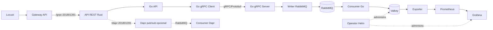

# Manual técnico — Proyecto 3 M.U.M.

## 1. Objetivo

El sistema procesa reportes militares simulados de cinco países. Cada reporte contiene país, aviones en aire, barcos en agua y fecha. La solución separa la recepción, transporte, mensajería, persistencia y visualización para poder escalar cada etapa.

## 2. Arquitectura



En local, Docker Compose sustituye al clúster y conecta los mismos binarios mediante la red `so1-p3-mum-201801391`. En GKE, los objetos se aíslan en `so1-proyecto3`.

## 3. Estructura del mensaje

```json
{
  "country": "USA",
  "warplanes_in_air": 17,
  "warships_in_water": 9,
  "timestamp": "2026-09-28T12:00:00Z"
}
```

La API valida los países `USA`, `RUS`, `CHN`, `ESP`, `GTM`; de 0 a 50 aviones; y de 0 a 30 barcos. El país asignado al carné terminado en 1 es **USA**.

## 4. Flujo de datos

1. Locust crea un JSON válido y lo envía a `/grpc-201801391`.
2. Rust valida el reporte, agrega un UUID si falta y lo reenvía a `go-api`.
3. `go-api` entrega el reporte al contenedor `grpc-client`.
4. El cliente convierte el modelo JSON al contrato Protobuf y llama `SendReport`.
5. `grpc-server` reconstruye el modelo y solicita su publicación a `rabbit-writer`.
6. El writer declara una cola durable y publica un mensaje persistente en RabbitMQ.
7. El consumidor usa confirmación manual. Confirma el mensaje solamente después de almacenarlo en Valkey.
8. Una operación Lua atómica actualiza contadores, máximos, mínimos, frecuencias y valores por país.
9. El exporter traduce las claves de Valkey a métricas Prometheus.
10. Grafana consulta Prometheus y presenta las doce visualizaciones requeridas.

## 5. Comunicación REST y gRPC

Rust expone HTTP porque es el punto de entrada público. Entre los servicios Go se usa gRPC con el contrato `services-go/proto/warreport.proto`. El enum del contrato evita países desconocidos y el RPC `SendReport` devuelve el identificador aceptado. Los tiempos de espera de las llamadas evitan solicitudes bloqueadas indefinidamente.

Los dos contenedores de entrada (`go-api`, `grpc-client`) comparten el pod `go-entry`. Los dos contenedores de procesamiento (`grpc-server`, `rabbit-writer`) comparten `go-processing`, conforme a la separación solicitada.

## 6. RabbitMQ y consistencia

La cola `war-reports` es durable y los mensajes usan modo persistente. El consumidor limita mensajes sin confirmar con QoS, rechaza datos inválidos y reencola errores transitorios. El `Ack` ocurre después de que Valkey confirma la transacción, lo que reduce la posibilidad de perder reportes.

## 7. Valkey y agregación

Valkey mantiene:

- total general y total por país;
- sumas y valores actuales de aviones y barcos por país;
- máximos y mínimos generales;
- conjuntos ordenados de frecuencia para obtener las modas;
- una lista reciente por país.

El script Lua actualiza todo de forma atómica. El operador crea el StatefulSet, Service y PVC a partir de `ValkeyInstance`.

## 8. Operator SDK basado en Helm

`operator/watches.yaml` registra dos tipos del grupo `so1.usac.edu.gt/v1alpha1`:

- `ValkeyInstance`, enlazado a `helm-charts/valkeyinstance`;
- `GrafanaInstance`, enlazado a `helm-charts/grafanainstance`.

Cada cambio en un recurso personalizado provoca una reconciliación del chart correspondiente. Los charts usan StatefulSets y PVC, por lo que conservan los datos al recrear pods. Grafana también recibe el datasource de Prometheus y el dashboard provisionado. RBAC permite al controlador observar los CR y administrar los recursos resultantes.

## 9. Gateway API

El `Gateway` usa la clase `gke-l7-global-external-managed`. Un `HTTPRoute` enlaza `/grpc-201801391`, `/dapr-201801391` y `/health` con el Service `rust-api`. `HealthCheckPolicy` obliga al balanceador de GKE a comprobar `/health` en el puerto 8080.

El cuerpo del enunciado exige Gateway API, aunque una fila de la rúbrica conserva el texto “Ingress”. La implementación sigue la especificación principal y no crea un Ingress paralelo.

## 10. HPA y recursos

El HPA de `rust-api` usa `autoscaling/v2`, mínimo 1, máximo 3 y objetivo de CPU promedio de 30 %. Todos los componentes propios tienen `requests` y `limits`, necesarios para que Kubernetes calcule el porcentaje de CPU y para evitar competencia ilimitada por recursos.

## 11. Zot y artefacto OCI

Zot se prepara como registro HTTPS externo. Las imágenes de Rust, los seis servicios Go, el consumidor Dapr y el operador se etiquetan bajo `so1/*`. En GCP, Zot debe vivir en una VM separada de GKE y presentar un certificado TLS válido para el nombre usado por los nodos.

`artifacts/countries.json` es el artefacto OCI de entrada. `scripts/push_oci_artifact.sh` lo publica con tipo `application/vnd.so1.countries.v1+json` y luego invoca `scripts/pull_oci_artifact.sh` para descargarlo desde el registry, validarlo y guardarlo en `runtime/oci/countries.json`. Locust lee esa copia descargada para construir la lista de países. En Kubernetes, un init container de ORAS descarga el mismo artefacto a un volumen `emptyDir` antes de iniciar Locust.

## 12. Dashboard

El dashboard provisionado incluye:

1. máximo y mínimo de aviones;
2. máximo y mínimo de barcos;
3. top de países por aviones y por barcos;
4. moda de aviones y de barcos;
5. series temporales de aviones y barcos para USA;
6. nombre del país asignado;
7. cantidad de reportes de USA.

## 13. Ruta opcional Dapr

La ruta `/dapr-201801391` publica el mismo mensaje mediante el sidecar Dapr y el componente `pubsub.rabbitmq`. `dapr-consumer` recibe la suscripción en `/dapr/war-reports` y escribe mediante la misma capa de Valkey. El flujo queda aislado en `k8s/dapr` para instalarlo solamente cuando Dapr exista en el clúster.

## 14. Falco opcional

`k8s/falco/values.yaml` define una regla que detecta la lectura de `/etc/mum/sensitive-201801391.txt`. La imagen Rust contiene ese archivo de demostración sin datos privados. En GKE se instala con `scripts/install_falco_optional.sh`; luego se ejecuta `kubectl exec -n so1-proyecto3 deploy/rust-api -- cat /etc/mum/sensitive-201801391.txt`. La evidencia debe mostrar tanto la regla como la alerta obtenida en los logs.

## 15. Pruebas y conclusiones

Las pruebas unitarias comprueban límites del modelo en Rust y Go. `tests/smoke_local.sh` verifica el aumento del contador en Valkey y la exposición en Prometheus/Grafana. Locust cubre carga interactiva y automática. Antes de entregar en GCP se debe medir el mismo escenario con una y dos réplicas de `go-processing`, registrar solicitudes por segundo, latencia p95 y fallos, y añadir los resultados reales en [evidencias.md](evidencias.md).

La separación de responsabilidades permite escalar la API sin duplicar el estado. RabbitMQ absorbe picos, Valkey ejecuta agregaciones rápidas y el operador conserva una instalación declarativa y repetible de la capa de datos y visualización.

## 16. Respuestas preparadas para la evaluación

### ¿Por qué RabbitMQ está entre gRPC y Valkey?

Desacopla la recepción del almacenamiento. Si Valkey se ralentiza, RabbitMQ retiene mensajes y el productor puede continuar hasta alcanzar los límites del broker.

### ¿Qué garantiza el operador?

Compara continuamente el estado solicitado en cada CR con los StatefulSets, Services, ConfigMaps y PVC existentes. Si se elimina un recurso administrado, el controlador lo recrea; si cambia el CR, actualiza el release Helm.

### ¿Cómo funciona el HPA?

Kubernetes compara el consumo medio real con el request de CPU de los pods Rust. Por encima del 30 % calcula más réplicas, hasta tres. La reducción tiene una ventana de estabilización de 60 segundos.

### ¿Por qué se usa un exporter?

Grafana trabaja bien con series de Prometheus. El exporter convierte las estructuras internas de Valkey en métricas etiquetadas por país sin exponer Valkey directamente al exterior.

### ¿Cuál es la diferencia entre el flujo base y Dapr?

El flujo base controla explícitamente el contrato gRPC y la publicación AMQP. Dapr mueve la integración pub/sub al sidecar y al componente declarativo, reduciendo código de infraestructura a cambio de más componentes operativos.
